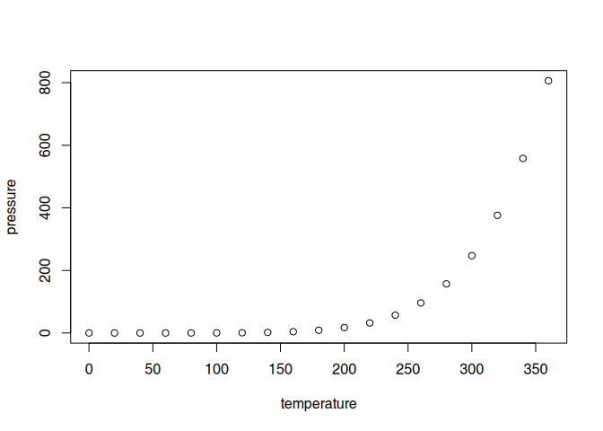

<!-- README.md is generated from README.Rmd. Please edit that file -->

# dafthelper

<!-- badges: start -->

<!-- badges: end -->

## Installation

You can install the development version of dafthelper like so:

``` r
pak::pak("bihealth/dafthelper")
```

## Quick start

Start R in a directory where you want to create a DAFT structure, then
run:

``` r
library(dafthelper)
use_daft()
#> ✔ Created subdirectory: './01_data'
#> ✔ Created subdirectory: './02_analysis'
#> ✔ Created subdirectory: './03_figures'
#> ✔ Created subdirectory: './04_text'
#> ! README.md file already exists, not overwriting.
```

This will create the following structure:

    01_data/
    02_analysis/
    03_figures/
    04_text/
    README.md

Now add a script to the 02_analysis directory. The following command
will initialize the script using a YAML header. By default, and unless
you specify the files yourself, some mock input / output files are
defined:

``` r
daft_new_script("02_analysis/my_analysis.R")
#> ✔ Created new script file: './02_analysis/my_analysis.R'
```

What is special about using `README.Rmd` instead of just `README.md`?
You can include R chunks like so:

``` r
summary(cars)
#>      speed           dist       
#>  Min.   : 4.0   Min.   :  2.00  
#>  1st Qu.:12.0   1st Qu.: 26.00  
#>  Median :15.0   Median : 36.00  
#>  Mean   :15.4   Mean   : 42.98  
#>  3rd Qu.:19.0   3rd Qu.: 56.00  
#>  Max.   :25.0   Max.   :120.00
```

You’ll still need to render `README.Rmd` regularly, to keep `README.md`
up-to-date. `devtools::build_readme()` is handy for this.

You can also embed plots, for example:



In that case, don’t forget to commit and push the resulting figure
files, so they display on GitHub and CRAN.
